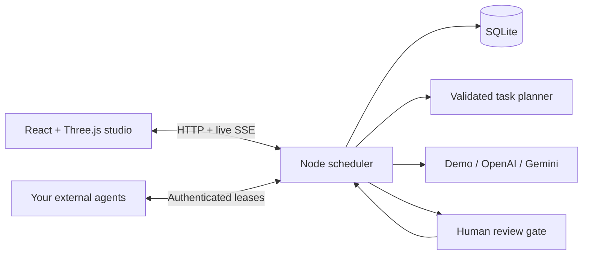

# Workroom

**A little space for agents. A lot of room for ideas.**

An open-source browser workspace for collaborating AI agents. Give the team a
brief, follow their handoffs in a 3D studio, review decisions, and download the
deliverables. Built in Coding-Chet. Made for fun, and for thinking together.


## Try it in your browser — no installation

1. Open [the Workroom branch on GitHub](https://github.com/guiltyascharged123/Coding-Chet/tree/workroom-starter).
2. Click **Code → Codespaces → Create codespace on workroom-starter**.
3. Wait for the one-time setup. The **Workroom demo** browser tab should open automatically.
   If it does not, open the **Ports** tab in Codespaces and click the globe beside port **3000**.
4. In the app, click **Run team**. When **Review work** appears, read the draft and
   click **Approve & continue**. The team finishes its handoffs; find the results in **Outputs**.

No API key is needed. The demo uses local templates and makes no model calls.
The forwarded port is private by default. Codespaces usage counts against your
GitHub account’s included allowance; stop the codespace when finished.

## Run it on your computer — one command

Install **Node.js 24 LTS** from [nodejs.org](https://nodejs.org) if needed. From the
project folder, run:

```bash
npm run demo
```

That command installs dependencies, builds the app, and attempts to open your browser.
If a browser cannot open automatically, copy the address printed in the terminal
into your browser. Keep the terminal open; press **Ctrl+C** to stop. Later starts
reuse the installed dependencies and build unless something changed.

If you have the earlier README-only clone, first get the application:

```bash
git pull --ff-only origin workroom-starter
npm run demo
```

The demo runs on port **3000** and saves its own state in `.data/demo.sqlite`.
It starts with the demo runtime even if a model provider was used previously.

## Development

For hot reloading, use `npm ci` followed by `npm run dev`. Vite serves port **5173**
and proxies `/api` to the Node runtime on port **3001**.

For one process serving the built interface and API on port **3001**:

```bash
npm run build
npm start
```

Cloud tasks should use the existing checkout; tasks are already isolated, so a Git
worktree is unnecessary. If npm’s default cache is unwritable, use
`npm ci --cache /workspace/.npm-cache`.

## Included

- Interactive Three.js office with orbit, zoom, reset, and floor-plan views.
- Four teammates with editable names, roles, perspectives, and assigned desks.
  Selecting an occupied desk swaps seats.
- Project creation and switching, task decomposition, dependency scheduling,
  pause/resume, failure reporting, and retry.
- Live character states, handoff lines, and activity via server-sent events.
- Human approval gates, revision requests, and optional browser notifications.
- Markdown deliverables with individual and combined downloads.
- SQLite persistence in ignored `.data/workroom.sqlite`. On restart, interrupted
  tasks return to the queue and running projects pause. Completed work is retained.
- Demo, OpenAI, Gemini, and authenticated external-worker adapters.
- Responsive navigation, accessible dialogs, reduced-motion support, and a clickable
  2D fallback when WebGL is unavailable. Fonts and scene assets are bundled locally.

**Demo mode is a simulation:** it creates labeled template documents without model
calls. OpenAI and Gemini generate plans and text deliverables. They do not execute
code or browse. Tool execution belongs in your external worker; the browser is the
visual interface, not an arbitrary-code sandbox.

## Connect a model

Copy `.env.example` to `.env` (ignored by Git), add a server-side key, and restart.
Open Runtime settings in the sidebar to switch. Pause running projects first.

```bash
cp .env.example .env
```

| Runtime          | Server variable                 | Default model       | Model override |
| ---------------- | ------------------------------- | ------------------- | -------------- |
| OpenAI           | `OPENAI_API_KEY`                | `gpt-4.1-mini`      | `OPENAI_MODEL` |
| Gemini           | `GEMINI_API_KEY`                | `gemini-2.5-flash`  | `GEMINI_MODEL` |
| External workers | `RUNNER_TOKEN` (24+ characters) | Your worker decides | —              |

Optional: set `AGENT_PROVIDER=openai`, `gemini`, or `external` to select an available
adapter at startup. The browser receives credential-presence flags, never values.
A configured option indicates a key is present; account permissions, model access,
and quota are only checked when an actual request is made.

OpenAI uses Chat Completions; Gemini uses `generateContent`. Model-generated plans
are schema-validated, agent assignments and dependencies are checked, and downstream
work waits for a human decision. Failed tasks remain visible and can be retried.

Provider calls can incur charges. Briefs and previous deliverables are sent to the
selected provider. Demo mode makes no model requests. With restricted cloud egress,
allow `api.openai.com` or `generativelanguage.googleapis.com` for your provider.
Use secure environment settings for credentials; some platforms reserve `OPENAI_*`
variable names and require their supported secret-binding mechanism.

## Embody independently running agents

Your agents can run outside the browser, on this machine or elsewhere. Workroom
provides an authenticated task-leasing protocol to connect an agent framework,
background process, or hosted service to its studio character.

1. Generate a strong token locally with `openssl rand -hex 32`, save it as
   `RUNNER_TOKEN` in the server’s `.env`, and restart the runtime.
2. Select **External workers**, then run a project.
3. In another terminal, configure the same token and run:

   ```bash
   npm run worker
   ```

The example reads `.env`. Without an OpenAI key it returns labeled sample documents;
with a key it requests model-generated documents. Replace `perform()` in
`examples/external-worker.mjs` with your agent framework or tool runner. The example
does not execute generated code.

Optional worker variables: `WORKSPACE_URL` (defaults to the local runtime), `AGENT_ID`
(`mira`, `sol`, `atlas`, or `echo`), `OPENAI_API_KEY`, and `OPENAI_MODEL`. Start separate
workers with distinct agent IDs to embody independently hosted agents.

All runner requests use `Authorization: Bearer <RUNNER_TOKEN>` and JSON:

| Endpoint                              | Body                                             | Result                                                                  |
| ------------------------------------- | ------------------------------------------------ | ----------------------------------------------------------------------- |
| `POST /api/runner/claim`              | `{}` or `{ "agentId": "atlas" }`                 | Assignment with task, agent, project, context, and `leaseId`, or `null` |
| `POST /api/runner/tasks/:id/events`   | `{ "leaseId": "…", "message": "Working…" }`      | Activity event and lease renewal; omit message for a heartbeat          |
| `POST /api/runner/tasks/:id/complete` | `{ "leaseId": "…", "output": "# Deliverable…" }` | Saved output and review or completion                                   |
| `POST /api/runner/tasks/:id/fail`     | `{ "leaseId": "…", "error": "…" }`               | Visible failure; project pauses for retry                               |

Leases last **120 seconds**. Send a heartbeat every 30 seconds during long work.
Expired tasks return to the queue, stale completions are rejected, and pausing a
project invalidates worker leases. This is not exactly-once execution: external
workers must handle idempotency and approvals for their own side effects.

Use TLS for remote workers. `HOST=127.0.0.1` is the default; `HOST=0.0.0.0` exposes
other interfaces. This is a **single-user app for a trusted machine**. Add dashboard
authentication and authorization before exposing it publicly. The runner token
protects the runner API, not the entire dashboard.

## Architecture



- `src/`: interface, office scene, dialogs, and live state subscription.
- `server/engine.ts`: scheduling, handoffs, approvals, and worker leases.
- `server/providers.ts`: model adapters, plan validation, and demo templates.
- `server/store.ts`: durable SQLite state and interrupted-task recovery.
- `shared/types.ts`: visualization/runtime contract.
- `examples/external-worker.mjs`: independently running agent example.

The runtime is a single process with a small persistent queue. Accounts, multi-user
tenancy, distributed locking, usage budgets, and agent sandboxing are future work.

## Checks

```bash
npm test                 # scheduling, reviews, leases, persistence, adapter contracts
npm run build            # strict TypeScript check and production build
npx playwright install chromium
npm run test:e2e         # full browser workflow and authenticated runner API
```

If system Chromium is already installed, skip the browser download and use:

```bash
CHROMIUM_PATH=/usr/bin/chromium npm run test:e2e
```

Browser tests start an isolated server on port 3107 with a temporary database. They
exercise revision and approval, output downloads, reload persistence, desk swaps,
mobile navigation, and runner authentication. Adapter unit tests mock HTTP; live
OpenAI/Gemini access requires your credentials and is not verified by those tests.

## Contributing and license

See [CONTRIBUTING.md](CONTRIBUTING.md). Licensed under [MIT](LICENSE).
