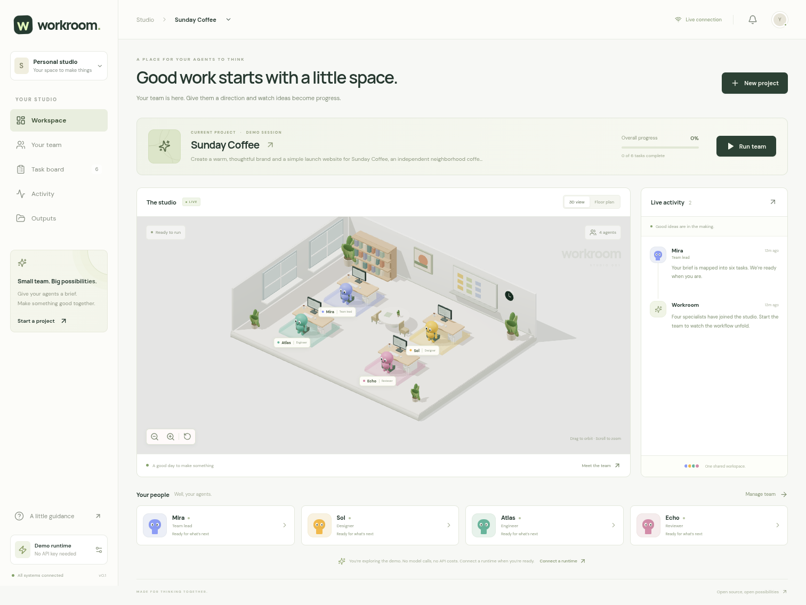
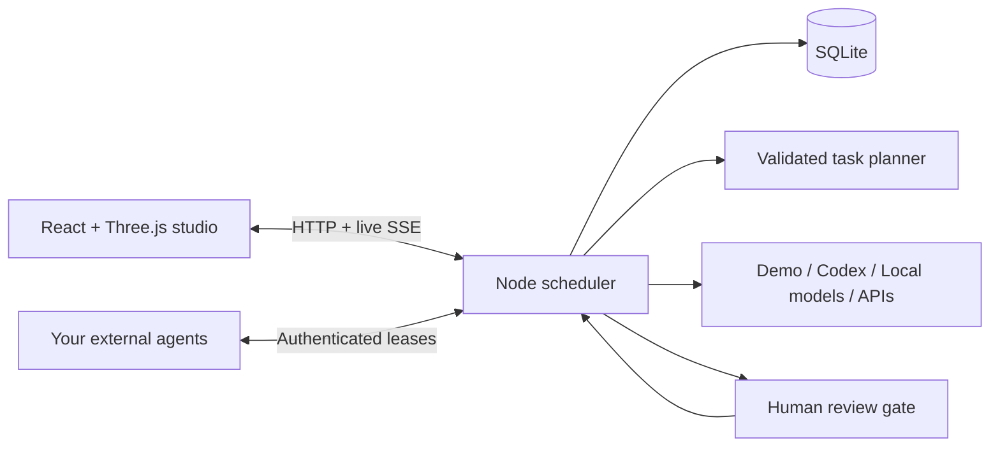

# Workroom

**A little space for agents. A lot of room for ideas.**

An open-source browser workspace for collaborating AI agents. Give the team a
brief, follow their handoffs in a 3D studio, review decisions, and download the
deliverables. Built in Coding-Chet for office coordination, planning, research and Codex software delivery.

**Start here:** [Easy guide: run Workroom, connect ChatGPT/Codex, and understand account safety](docs/EASY-GUIDE.md).
It covers the first project, everyday startup, costs, disconnecting, and common problems.



## Try it in your browser — no installation

1. Open [the Workroom branch on GitHub](https://github.com/guiltyascharged123/Coding-Chet/tree/workroom-starter).
2. Click **Code → Codespaces → Create codespace on workroom-starter**.
3. Wait for the one-time setup. The **Workroom demo** browser tab should open automatically.
   If it does not, open the **Ports** tab in Codespaces and click the globe beside port **3000**.
4. In the app, click **Run team**. When **Review work** appears, read the draft and
   click **Approve & continue**. The team finishes its handoffs; find the results in **Outputs**.

No API key is needed. The demo uses local templates and makes no model calls.
The forwarded port is private by default. Codespaces usage counts against your
GitHub account’s included allowance; stop the codespace when finished.

## Run it on your computer — one command

Install **Node.js 24 LTS** from [nodejs.org](https://nodejs.org) if needed. From the
project folder, run:

```bash
npm run local
```

That command installs dependencies, builds the app, and attempts to open your browser.
If a browser cannot open automatically, copy the address printed in the terminal
into your browser. Keep the terminal open; press **Ctrl+C** to stop. Later starts
reuse the installed dependencies and build unless something changed.

If you have the earlier README-only clone, first get the application:

```bash
git pull --ff-only origin workroom-starter
npm run local
```

The saved workspace runs on port **3001** by default and uses `.data/workroom.sqlite`.
Set `PORT` in `.env` to choose another port. For a separate test drive, `npm run demo`
uses port **3000**, `.data/demo.sqlite`, and starts in Demo mode.

On Windows, use the same commands in PowerShell or Command Prompt. If PowerShell
blocks npm scripts, use `npm.cmd run local`. See the [local setup and migration
guide](docs/LOCAL-SETUP.md) to bring your Codespaces projects home using a portable backup.

## Update an existing copy

On your computer, stop the app with **Ctrl+C**, then run:

```bash
git pull --ff-only origin workroom-starter
npm run local
```

In an existing Codespace, run these in its terminal instead:

```bash
git pull --ff-only origin workroom-starter
npm run codespace:restart
```

Refresh the app's browser tab after restarting. Saved projects and documents stay
in the database. Create a new project, choose a team and workflow, then use **Edit plan** to customize its assignments; existing projects keep their original tasks and results.

## Development

For hot reloading, use `npm ci` followed by `npm run dev`. Vite serves port **5173**
and proxies `/api` to the Node runtime on port **3001**.

For one process serving the built interface and API on port **3001**:

```bash
npm run build
npm start
```

Cloud tasks should use the existing checkout; tasks are already isolated, so a Git
worktree is unnecessary. If npm’s default cache is unwritable, use
`npm ci --cache /workspace/.npm-cache`.

## Included

- Slate, walnut, and brass interface with readable text and an interactive Three.js office.
  Agents walk around furniture, visit the planning wall, meeting area, coffee counter,
  and printer, and meet for runtime handoffs. Orbit, zoom, floor-plan, and a separate
  movement pause control are included. Reduced motion starts with movement paused.
- Four teammates with editable names, roles, perspectives, and assigned desks.
  Selecting an occupied desk swaps seats.
- Project creation and switching, task decomposition, dependency scheduling,
  pause/resume, failure reporting, and retry.
- Live task states and handoffs via server-sent events; the office visualizes their activity.
- Human approval gates, revision requests, and optional browser notifications.
- Saved team discussions: specialist proposals, adversarial critique and chair decisions, optional kickoff/milestone meetings, usage receipts and retry of remaining contributions.
- Purposeful office movement: focused desk work, reviews, handoffs and a meeting room tied to real meeting state.
- Ten specialist presets, selectable Codex reasoning, venture validation and optional read-only Codex web research.
- Autosaved browser drafts for review feedback, retry directions, memory, agendas and plan edits.
- Project-specific team presets for office coordination, research, software delivery and custom work; editable plans with flexible task counts, owners, dependencies and approval gates. Legacy office packs and their exports remain supported.
- Codex software assignments edit, review and test actual files in a shared managed project folder, with tool activity, blocked results, a source browser and ZIP downloads. Coding readiness is checked locally before execution.
- Briefs are saved before AI planning, unfinished form drafts survive reloads, and failed plans offer retry or template fallback.
- Editable Word (`.docx`) documents, Excel (`.xlsx`) workbooks with separate table sheets
  and calculated budget totals, Markdown, and Print / PDF exports. Individual and combined
  downloads preserve draft/review status. Excel notes retain the narrative context.
- SQLite persistence in ignored `.data/workroom.sqlite`. On restart, interrupted
  requests without confirmed receipts become uncertain and pause for review. Completed work is retained.
- Demo, ChatGPT-authenticated Codex, Ollama, OpenAI-compatible servers, OpenAI, Gemini,
  and authenticated external-worker adapters. Existing projects retain their connection/model.
- Workspace controls: paid APIs disabled by default, editable economy limits, request receipts,
  estimated API reservations/budgets, uncertain-request acknowledgment, and project-scoped caching.
- Verified project memory with document provenance and stale-source detection.
- Validated portable backup/restore, automatic recovery snapshots, and migration between computers.
- Responsive navigation, accessible dialogs, reduced-motion support, and a clickable
  2D fallback when WebGL is unavailable. Fonts and scene assets are bundled locally.

**Demo mode is a simulation:** no AI or tools run. Normal new workspaces start empty. Editable templates create no model request; optional AI planning does. Office/research/venture/custom model assignments generate text by default, with optional built-in Codex web research. **Software delivery uses Codex file and command tools**, and other Codex teams can explicitly enable them too, after the local sandbox readiness check passes. See the [easy guide](docs/EASY-GUIDE.md) for a first run, task retries, managed files and limitations.

## Connect a model

See the [AI connection guide](docs/AI-CONNECTIONS.md) for a plain-language comparison,
step-by-step provider setup, built-in Codex coding tools, and custom worker options.

Copy `.env.example` to `.env` (ignored by Git), configure the connection and restart.
Select the default for new projects in Runtime settings. To switch an existing
project, pause it and explicitly choose its connection in Workspace controls.

| Connection        | What you supply                                                                   |
| ----------------- | --------------------------------------------------------------------------------- |
| Codex             | ChatGPT sign-in through the bundled Codex CLI; enabled account and exact model ID |
| Ollama            | Running local service and installed model tag                                     |
| OpenAI-compatible | Local/HTTPS server URL and exact model ID; authentication if needed               |
| OpenAI / Gemini   | Server API key, compatible model, API quota, explicit paid permission and prices  |
| External workers  | Strong runner token and your separately running worker                            |

One model can serve all agent roles and bounded goals. For about 16 GB RAM with
integrated graphics, first evaluate a quantized 3–4B instruct model with a single
active task. Model weights are not bundled or automatically downloaded. A ChatGPT
subscription can supply Codex allowance when the account includes access; it does
not supply paid API credits. There is no automatic paid API fallback.

Economy defaults: one active task, 30 tasks/project, one revision/task, 30 requests
per rolling day. Paid API estimates default to $2/day and $1/project, with paid
requests disabled until explicitly enabled and exact-model prices supplied.
Application estimates do not cap unrelated account spending or external workers.

The [connection guide](docs/AI-CONNECTIONS.md) covers actual commands, metadata checks,
quota limitations, local hardware, memory, and custom worker frameworks. Briefs and
relevant documents go to the chosen model; credential values stay on the server.
With restricted cloud egress, allow your provider's endpoints. Some platforms reserve
`OPENAI_*` variables and require their supported secret-binding mechanism.

## Embody independently running agents

Your agents can run outside the browser, on this machine or elsewhere. Workroom
provides an authenticated task-leasing protocol to connect an agent framework,
background process, or hosted service to its studio character.

1. Generate a strong token locally with `openssl rand -hex 32`, save it as
   `RUNNER_TOKEN` in the server’s `.env`, and restart the runtime.
2. Select **External workers**, then run a project.
3. In another terminal, configure the same token and run:

   ```bash
   npm run worker
   ```

The example reads `.env`. Without an OpenAI key it returns labeled sample documents;
with a key it requests model-generated documents. Replace `perform()` in
`examples/external-worker.mjs` with your agent framework or tool runner. The example
does not execute generated code.

Optional worker variables: `WORKSPACE_URL` (defaults to the local runtime), `AGENT_ID`
(`mira`, `sol`, `atlas`, or `echo`), `OPENAI_API_KEY`, and `OPENAI_MODEL`. Start separate
workers with distinct agent IDs to embody independently hosted agents.

All runner requests use `Authorization: Bearer <RUNNER_TOKEN>` and JSON:

| Endpoint                              | Body                                             | Result                                                                  |
| ------------------------------------- | ------------------------------------------------ | ----------------------------------------------------------------------- |
| `POST /api/runner/claim`              | `{}` or `{ "agentId": "atlas" }`                 | Assignment with task, agent, project, context, and `leaseId`, or `null` |
| `POST /api/runner/tasks/:id/events`   | `{ "leaseId": "…", "message": "Working…" }`      | Activity event and lease renewal; omit message for a heartbeat          |
| `POST /api/runner/tasks/:id/complete` | `{ "leaseId": "…", "output": "# Deliverable…" }` | Saved output and review or completion                                   |
| `POST /api/runner/tasks/:id/fail`     | `{ "leaseId": "…", "error": "…" }`               | Visible failure; project pauses for retry                               |

Leases last **120 seconds**. Send a heartbeat every 30 seconds during long work.
Expired tasks stop for review of uncertain usage before explicit retry; stale
completions are rejected, and pausing invalidates worker leases. This is not exactly-once execution: external
workers must handle idempotency and approvals for their own side effects.

Use TLS for remote workers. `HOST=127.0.0.1` is the default; `HOST=0.0.0.0` exposes
other interfaces. This is a **single-user app for a trusted machine**. Add dashboard
authentication and authorization before exposing it publicly. The runner token
protects the runner API, not the entire dashboard.

## Architecture



- `src/`: interface, office scene, dialogs, and live state subscription.
- `server/engine.ts`: scheduling, handoffs, approvals, and worker leases.
- `server/providers.ts`: model adapters, plan validation, and demo templates.
- `server/store.ts`: durable SQLite state and interrupted-task recovery.
- `shared/types.ts`: visualization/runtime contract.
- `examples/external-worker.mjs`: independently running agent example.

The runtime is a single process with a small persistent queue. Accounts, multi-user
tenancy, distributed locking and general tool-worker isolation remain future work.
Built-in document generation has bounded scheduling and application usage estimates.

## Checks

```bash
npm test                 # scheduling, reviews, leases, persistence, adapter contracts
npm run build            # strict TypeScript check and production build
npx playwright install chromium
npm run test:e2e         # full browser workflow and authenticated runner API
```

If system Chromium is already installed, skip the browser download and use:

```bash
CHROMIUM_PATH=/usr/bin/chromium npm run test:e2e
```

Document tests inspect the actual Word/Excel file contents and budget formulas.
Office tests exercise furniture clearance, character separation, continued movement,
physical handoff meetings, and desk reassignment.

Browser tests start an isolated server on port 3107 with a temporary database. They
exercise revision and approval, output downloads, reload persistence, desk swaps,
mobile navigation, and runner authentication. Adapter unit tests mock HTTP; live
OpenAI/Gemini access requires your credentials and is not verified by those tests.

## Contributing and license

See [CONTRIBUTING.md](CONTRIBUTING.md). Licensed under [MIT](LICENSE).

Managed source folders live beside the database under `.data/projects/` by default. Workspace JSON backups contain records and reports, **not source files**; copy managed folders separately or use Outputs → Download source ZIP. The coding worker is bounded to project files plus read access for system tooling; tool network starts disabled and can be enabled per project for dependency downloads. Native execution must pass the local readiness check. Development verified native configuration and mocked worker contracts; the cloud host cannot start the native coding sandbox because of its reserved socket-directory permissions. No live account generation or unrestricted fallback was used.

### Evidence-based team work

Each project has a visible **Model → Change** control for its connection and exact model ID. Direct model tasks report deliverables, acceptance evidence, assumptions, concrete human decisions and bounded internal follow-ups. Large handoffs use budgeted source excerpts and targeted retrieval rather than failing on accumulated prose. Any Codex team can explicitly enable managed file/command tools; sandbox and cost controls still apply. Project instruction improvements are reviewable and versioned. See the [easy guide](docs/EASY-GUIDE.md#useful-work-evidence-and-recovery) for usage and limits. Model-reported checks are not proof of correctness; actual receipts and independent review matter.
