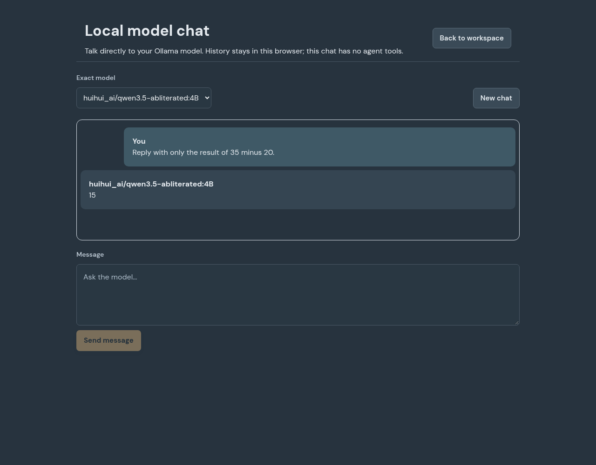

# Specialist interaction and small local models

The recovery baseline is `22ff080b33b88881eba8f45e9c3de37dc5a27b30`.
The uploaded source archive and GitHub main both matched it. No unfinished work
from the earlier environment was present in that checkout.

## Working method

Each specialist receives its role procedure, specific goal, current assignment,
acceptance checks and an interaction template. Templates select different lenses:
independent falsification, constructive experiments, quantitative challenge,
mechanism discovery, user-centered reframing and adaptive coordination. Review
assignments override the author's ordinary lens. These are working instructions,
not evidence of expertise or separate trained models.

Creative exploration asks for different causal mechanisms, a simple baseline,
cross-domain ideas, disconfirming evidence and a bounded experiment with a stop
condition. It does not require a report or meeting for every step. Normal focused
delivery remains available. The idea investigation action now requests an actual
bounded test when authorized tools permit, or an explicitly unexecuted proposal
when they do not. Saved idea evaluations and their investigation source IDs feed
future requests. An evaluated idea is still a reported finding, not automatically
verified truth or approval to implement it.

Ollama task requests use a shorter interaction contract with the same nested
bounds and acceptance validation. Their grammar requires only outcome, deliverable
and checks, with optional decisions, specialist assignments and useful ideas.
Summary, handoff and improvement reporting fields are excluded from local output;
the app derives a verbatim summary excerpt and an empty handoff without inventing
facts or assumptions. Raw replies remain saved. Role methods are supplied once,
and structured local requests use temperature 0.2 to reduce format variation;
mechanism diversity comes from specialist methods rather than random wording.
The current turn explicitly
distinguishes initial work, reading retrieved evidence and correcting a rejected
response. Corrections identify field-level defects, retain useful work and respect
the configured correction/request limits. Nothing silently changes providers.

## Durable working memory

SQLite remains the authoritative record. Each specialist receives a compact
working-memory packet reconstructed from up to three earlier results assigned to
that specialist in the same project. It includes reported outcomes, checks,
assumptions, next actions, errors and original source IDs. Direct dependencies
already supplied as teammate evidence are not duplicated. Old brief revisions are
labeled historical. Restarting the server reconstructs the packet from saved
results; no extra summarization model call is needed.

Working-memory sources participate in context budgeting and the visible context
report. Full originals remain retrievable by source ID. They are never promoted
to human-verified memory. Tool-capable agents also get the existing temporary,
read-only source bundle; text-only Ollama does not pretend to read local files.
This avoids a second set of mutable memory files drifting from the database.

## Tools and extensions

The Ollama adapter currently generates text and can retrieve saved project
evidence. It does not execute arbitrary shell commands. For actual software
modules, explicitly configure the existing Codex workspace executor. It can build
project-owned utilities, test them, promote them through the utility lifecycle
manager and preserve rollback receipts. See
[Project tools and internet](PROJECT-TOOLS-AND-INTERNET.md). A proposed module is
not an installed capability. Native Ollama tool execution remains future work.

A malformed final record from a completed native tool job now gets a bounded
**text-only** correction. The correction has no project workspace, shell, file
tools or research. It passes through the existing usage ledger and limits.
Original tool observations are captured before correction; corrected claims
cannot create receipts. Missing observed acceptance evidence makes a purported
completion blocked. The implementation job is not automatically replayed.

## Inspect hardware and evaluate the exact model

```bash
npm run local:inspect
ollama pull huihui_ai/qwen3.5-abliterated:4B
npm run evaluate:local
```

`local:inspect` reports CPU threads, constrained/available RAM and free disk.
Weight and runtime estimates based on a parameter-count tag are explicitly rough;
quantization, KV cache, architecture and GPU offload can change actual needs.
Unknown tags remain unknown. The check does not detect a GPU or replace the
configured model. Normal local setup prints this advice before a download.

`evaluate:local` calls the installed exact model through the real Ollama adapter.
It runs arithmetic, a constrained creative experiment proposal and a separate
reviewer request receiving both original assignments and prior results. Arithmetic
uses focused delivery; the experiment uses an operations specialist in creative
mode, followed by a quality specialist. These bounded proposal evaluations disable
delegation instead of offering actions the assignment forbids. A valid but blocked
proposal stays failed and is still supplied as unaccepted evidence to the reviewer.
It can make additional bounded
format/retrieval calls. It never installs weights or uses a paid fallback.
Each run creates isolated SQLite records and a JSON receipt under
`.data/evaluations/`, separate from normal projects. Optional
`WORKROOM_EVALUATION_ROOT` changes the receipt directory. The test suite uses a
clearly named deterministic HTTP fixture to verify this command; those fixture
results are not live inference evidence.

Inspect the receipt's actual deliverables, assumptions and review findings. A
schema-valid response is not an automatic quality score. This small evaluation
does not establish autonomous software delivery, general creativity or success
on an external goal.

## Direct local chat

Run the app normally with `npm run local`, or start a prepared installation with
`npm start` while Ollama is running. Open the private pairing link printed in the
terminal, then choose **Local model chat**. The `/chat` path also opens it directly.
It works in a fresh empty workspace without creating a project or agent tasks.

Choose an installed exact model and send a message. Replies stream as Markdown;
**Stop reply** cancels the upstream model request and retains interrupted public
text. Complete conversation pairs and the message draft survive browser reload
in that browser's local storage, separately per model. Interrupted answers are
visible but are not silently supplied as completed context on the next request.
**New chat** clears that model's browser history. There are no file, shell or web
tools in this direct chat. It uses only the configured Ollama endpoint, with no
paid-provider fallback. It shares the app's browser pairing and CSRF boundary.
Conversation/request limits fail visibly instead of silently dropping completed
history. Running agent jobs can delay chat on a single-slot CPU model server.



The screenshot is from a real browser-to-Workroom-to-Ollama request, not the
deterministic browser fixture. The exact installed model returned `15` for the
request to answer only `35 minus 20`. Ollama 0.40.16 reported model digest
`9acbd90c2645120ea1e4a5fe7ec9c4fe000e547ccebc8a24f950315d582003e6`,
4.5B parameters, Q4_K_M quantization and CPU execution. A live response establishes
connectivity and this narrow case; it does not certify general agent quality.

In a cloud environment, `127.0.0.1` refers to that cloud computer. Use its browser
or port preview to reach the interface; your laptop's own localhost is separate.
This session exposed shell/headless-browser access, but no tool for opening a
forwarded preview or shared desktop viewer automatically.

## Software verification and observed limits

The production build and 195 unit/integration checks completed: 193 passed and
two native-sandbox checks skipped on this host. These include isolated SQLite
restart/provenance tests, real child-process/HTTP fixture tests, upstream chat
cancellation and native response recovery without redispatching the coding job.
Fixtures do not establish live model quality or account access.

The initial 40-case browser run had 37 passes and three failures while the build
directory was changing and software WebGL was competing with inference. The
planning/restart cases passed with a stable build. After adapting software
rendering, all five focused chat/office/export/fallback checks passed, including
the eight-/twelve-agent case. Software WebGL uses pixel ratio 1, no shadows and a
20 Hz redraw budget; hardware renderers retain the normal office settings.

Live evaluation exposed problems that successful transport/schema tests do not
catch: describing an artifact rather than delivering it, copying unrelated price
data into shop-cost claims, meaningless extra reporting fields and trying to
delegate a proposal that was explicitly bounded. The small-model packet and
outcome grammar were redesigned in response. Unsupported service-value or cost
claims must still be challenged against original inputs. A model marking its own
check met is not an independent quality verdict.

## Open-source framework review

Sources inspected November 14, 2026:

| Project and inspected revision                                                                                              | Useful pattern                                                     | Decision for Workroom                                                                                                                                   |
| --------------------------------------------------------------------------------------------------------------------------- | ------------------------------------------------------------------ | ------------------------------------------------------------------------------------------------------------------------------------------------------- |
| [LangGraph](https://github.com/langchain-ai/langgraph/blob/08a2016953789a4f579b4d36bd1967941ec62012/README.md)              | Durable execution, explicit state and human interrupts             | Keep saved results and observed side effects separate from response correction; preserve the existing SQLite/task scheduler.                            |
| [OpenAI Agents SDK](https://github.com/openai/openai-agents-python/blob/64fbde5d02b42ae5f9db668eb0184cdb3fc9d775/README.md) | Role instructions, agents as tools, handoffs, sessions and tracing | Use specific specialist templates and concrete bounded handoffs with observable requests. The existing Codex SDK remains the native workspace executor. |
| [AutoGen](https://github.com/microsoft/autogen/blob/8390985108cb1e3881f5f7297765758d8ad2540c/README.md)                     | Multi-agent conversation and tool workbenches                      | Its current README says the project is archived and points new users to Microsoft Agent Framework. Do not add an archived runtime as a new dependency.  |

These are pattern reviews of the linked sources, not comparative framework
benchmarks or claims that their runtimes have been integrated. Replacing the
scheduler would also require migrating existing projects, usage reservations,
uncertain attempts and review state. No second framework is installed merely to
give role prompts a new name. Existing external-worker bridges remain available.
