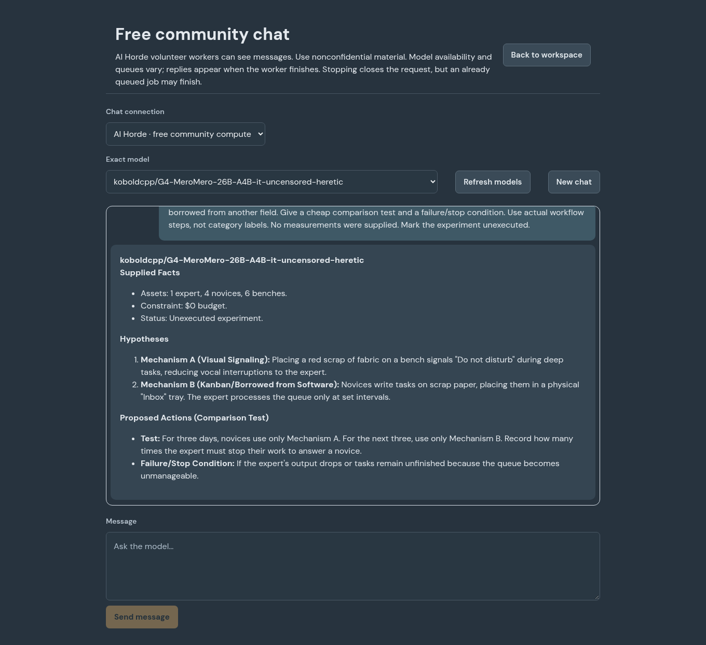

# Optional free community inference

**Model chat → Chat connection → AI Horde** lists currently advertised exact
models. This is explicit opt-in remote inference: volunteer operators can see
messages. Use nonconfidential examples. It has a separate browser history from
local Ollama; switching connections does not upload local chat or project data.
No AI Horde request is made by the chat page until this connection is selected.

The fixed endpoint is `https://oai.aihorde.net/v1`, using AI Horde's intentionally
public anonymous token documented by its [official project](https://github.com/Haidra-Org/AI-Horde).
No private saved API key is sent. A model must be explicitly listed and the
response must confirm its exact name; unavailable models fail visibly without
substitution. Use **Refresh models** to inspect availability. Volunteer queues
vary and anonymous jobs have low priority. Replies appear when complete rather
than streaming token by token. Stopping closes the request; already queued
work can still finish upstream.

To use it for project specialists, choose **Model connections → Compatible →
Use free AI Horde connection**, check availability, and deliberately select this
connection for a new project or pause/change an existing one. This sends the
project context needed by those tasks to volunteers. It uses the artifact-first
pipeline. Community billing is exempt from dollar estimates only for the exact
allowlisted HTTPS endpoint; request, output and other workspace limits remain.
Other remote compatible providers retain normal API spending controls. The local
Ollama default is unchanged.

## Actual live check

November 14, 2026: a real anonymous request to the advertised
`koboldcpp/G4-MeroMero-26B-A4B-it-uncensored-heretic` returned HTTP 200 and
`$35 - $20 = $15`, with reported usage of 58 input and 12 output tokens. An earlier
unavailable 31B model request returned 503; no substitution was made for that
request. The 26B was then explicitly chosen from the advertised list. These are
worker-reported model identities, not independently verified weight digests.
This establishes a narrow live inference path, not reliable hosting or superior
agent quality. Current availability can differ.

The actual browser → Workroom → community API path also answered a fictional
repair-shop problem with two unexecuted mechanisms (visual signals and a batched
question queue), a comparison test and a stop condition. The answer is useful
as a proposal, but the sequential test confounds learning/order effects and its
stop condition needs a sharper operational definition. It did not demonstrate
exceptional creativity or an executed improvement.

The managed cloud host requires its configured HTTPS proxy. Node's standard
proxy support now honors HTTP(S)_PROXY and NO_PROXY without disabling TLS checks.
The proxy and loopback bypass are verified with local HTTP fixture servers.

A further real specialist run used Workroom's artifact-first path: arithmetic
completed in two calls. A repair-shop proposal and review initially failed the
compact control-record validator (oversized evidence and a string in `decision`).
After the contract clarified field bounds and omission rules, assessment resumed
from the saved proposal; the reviewer received the newly available actual work.
Three assignments reached accepted control records across 11 total requests,
including the failed attempts and recoveries. That is not 11 successful answers.

Logical defects remained: the proposal used an arbitrary walking-distance stop
rule, and a review misinterpreted the buddy-escalation rule. A subsequent targeted
quote-based critique correctly distinguished walking distance from interruption
burden, but still misattributed a quote. No repair-shop improvement was executed.
These observations support a functioning pipeline and recoverable protocol,
not a claim of dependable autonomous reasoning. The source-grounded review
template now asks for exact passages and checks whether criticism follows from
them; role specialization alone is not an independent truth guarantee.

## Other hosting options reviewed

- [Hugging Face ZeroGPU](https://huggingface.co/docs/hub/spaces-zerogpu)
  provides shared, on-demand GPU time with quotas and eligibility requirements;
  it is not continuous free GPU hosting. Account setup/verification would be
  needed to deploy an owned Space.
- [Gemini](https://aistudio.google.com/docs/billing) and
  [Groq](https://console.groq.com/docs/rate-limits) have account-dependent free
  quotas. A user's own project/key is required; neither was live-tested here.
- [Oracle Always Free](https://docs.oracle.com/en-us/iaas/Content/FreeTier/freetier_topic-Always_Free_Resources.htm)
  has CPU resources subject to capacity/account conditions and idle reclamation,
  not a guaranteed GPU service. The current free-tier page lists 2 OCPU/12 GB
  for eligible free tenancies; older 4 OCPU/24 GB advice is not universal.

Public demo pages may be paused or charge the signed-in user's inference
provider. An accessible frontend alone does not establish free compute. No
unowned server, concealed billing route or quota evasion is part of this setup.
