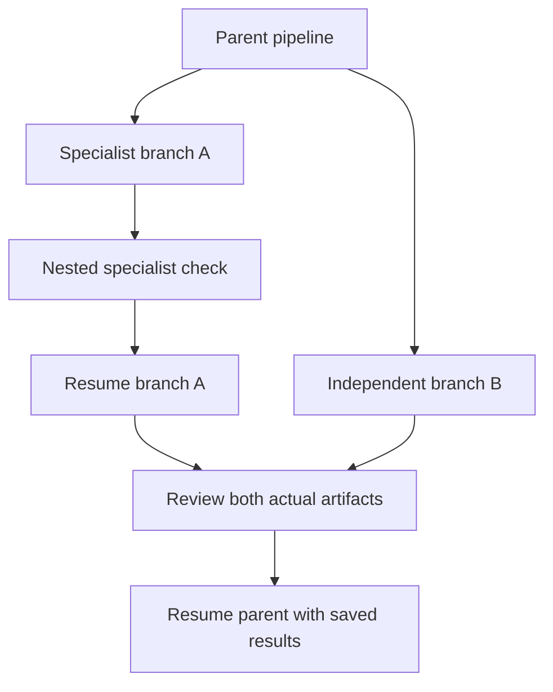

# Pipelines that delegate pipelines

Workroom uses its saved task graph as the controller. Models propose work and
specialist handoffs; application code validates dependencies, schedules ready
steps, enforces budgets, and retains results. A role name is not an executor or
proof of expertise.

## Small-model micro-pipeline

Ollama defaults to **write → checkpoint → assess → validate**. Writing is natural
Markdown without a JSON reporting envelope. Assessment returns a short control
record and acceptance checks; the application attaches the exact saved artifact,
so assessment cannot replace missing work with a better-sounding description.

The checkpoint includes a fingerprint of the model, specialist, current task,
brief, feedback and supplied evidence. An unchanged pending artifact resumes at
assessment after restart or a request-limit failure. Changed inputs invalidate
it. Confirmed provider receipts can be recovered offline across the save/result
transition; an interrupted or truncated request is not blindly replayed. Each
inference still has its own usage receipt and request reservation. Two stages
cost two calls; this separation trades overhead for recoverability and useful
artifacts, rather than claiming universal token savings. The legacy interaction
is available with `WORKROOM_OLLAMA_INTERACTION=structured` for explicit comparison.

Models can retrieve saved evidence and request `tool:calculate` with a numeric
expression in `query`. The calculator parses bounded arithmetic with exact
rational numbers; it never evaluates JavaScript. Each result or rejection gets
its own immutable `calculation:<id>` receipt, retrievable within its project.
Calculation verifies an operation, not the truth of inputs or business value.
New evidence can invalidate a draft; the assessor must block it for revision,
not secretly rewrite it or claim the experiment ran.

## Fork, join and resume



A `continue` result can propose up to three named specialist follow-ups:

```json
[
  { "title": "Compute baseline", "agentId": "sol", "dependsOn": [] },
  { "title": "Challenge assumptions", "agentId": "atlas", "dependsOn": [] },
  { "title": "Review both artifacts", "agentId": "echo", "dependsOn": [0, 1] }
]
```

This abbreviated example omits required descriptions. Empty dependencies start
independent branches from the parent's prerequisites. Indexes name earlier
siblings only; duplicates, self-dependencies and forward references are rejected
before child scheduling. Omitted/null dependencies retain serial behavior for
older clients. The parent joins **every** child before resuming with results.
A child can itself delegate within its own revision budget and the global task
limit. There is no unbounded recursive agent spawning.

Ready steps are dispatched immediately when a running task releases capacity.
The polling heartbeat remains for recovery and leases; stopping the engine also
stops completion-triggered dispatch. Independent branches can run up to the workspace concurrency limit. The same
specialist does not run two tasks concurrently; shared project file work stays
serialized. A CPU-only single-slot Ollama service may queue parallel requests,
so concurrency one is often appropriate there. Meetings and delegation are not
mandatory for a closed question. Text-only reviewers receive original
assignments and actual artifacts without the author's self-reported checks.
Their conclusions are still model reports, not an independent execution receipt.

For writing/running software, use the existing explicitly selected Codex workspace
executor and its readiness check. Local text inference plus a calculator is not
a local shell agent. Proposed add-ons remain proposals until built and tested.

## Growing project context

Source catalogs are evidence metadata, not mandatory instructions. Their entries
use a share of the remaining input budget; a notice points to the full retrievable
`source-index` when the inline list is abbreviated. Original source IDs, titles,
lengths and bodies stay saved. Required user directions and acceptance criteria
are not clipped to make room for catalog metadata.

A live-HTTP browser fixture with 55 queued coordinator replies exposed an earlier
failure after 45 accepted replies: inline catalog metadata pushed required input
past 24,000 bytes. The budgeted catalog fixes that case. The browser recovery
check also now selects a project through its actual menu, avoiding a test-only
local-storage/reload race that could inspect the wrong project's receipts.

## Source-level reviews

On November 14, 2026, shallow sparse checkouts of these public repositories were
imported into a separate scratch directory and their source and license files
read. Their code was not executed, installed into Workroom or copied wholesale.
These are design comparisons, not benchmark results or runtime integrations.

| Source, revision and license                                                                                         | Inspected implementation                                                                                                                                    | Application to Workroom                                                                                                                                                                                                                                    |
| -------------------------------------------------------------------------------------------------------------------- | ----------------------------------------------------------------------------------------------------------------------------------------------------------- | ---------------------------------------------------------------------------------------------------------------------------------------------------------------------------------------------------------------------------------------------------------- |
| [smolagents](https://github.com/huggingface/smolagents/tree/96f33faaf028479119ec8d34507b47694cf14e34), Apache-2.0    | `src/smolagents/agents.py` bounded `_run_stream` and `_validate_final_answer`; `memory.py` action steps retain observations, errors, timing and token usage | Keep step limits, actual observations and final checks distinct. Save artifacts and calculator receipts rather than manufacturing a transcript of specialist actions.                                                                                      |
| [LangGraph.js](https://github.com/langchain-ai/langgraphjs/tree/fa426b293b6ecccbf62b4f262475777b4bf86673), MIT       | `libs/checkpoint/src/memory.ts` namespaced checkpoints, parent checkpoint references and `putWrites` task/index deduplication                               | Key resumable work by inputs and preserve pending results. Workroom retains its SQLite store, request reservations and bounded dependency scheduler; it does not use this in-memory saver as durable storage.                                              |
| [Aider](https://github.com/Aider-AI/aider/tree/5dc9490bb35f9729ef2c95d00a19ccd30c26339c), Apache-2.0 (`LICENSE.txt`) | `aider/coders/editblock_coder.py` dry-run/apply/error paths; `aider/repomap.py` budgeted repository maps; base coder lint integration                       | Concrete artifacts and validation matter more than a claimed completion. Repository maps and exact edit tools are candidates for a later local coding executor. Aider's other-file fallback is not adopted: an explicit path mismatch should stay visible. |

The fork/join and artifact checkpoint implementations are Workroom changes,
compatible with saved projects. The external examples informed the design;
no claim is made that Workroom outperforms these frameworks.

## Validation limits from this cloud session

The final full unit/integration suite completed 214 checks: 212 passed, two native
sandbox checks skipped on this host. CPU-quota checks cover cgroup v2/v1,
fractional quotas, missing metadata and explicit thread overrides. The
production build passes. The final full browser suite passed all 42 checks,
including the 55-reply history/recovery case. Browser model and CLI responses
are deterministic fixtures; the live-model observations below are separate. Model fixtures validate orchestration and persistence;
they are not live-model benchmarks.

The requested Ollama model completed correctly labeled arithmetic in the
artifact-first pipeline, but produced 754 output tokens for that small answer.
Its subsequent creative assignment exhausted the configured 2,000 output tokens
and invented timing estimates. The run stopped, retained its partial receipt and
never called a fallback. No independent review of that truncated case completed.
With the later concise contract, both installed local models completed the
same bounded arithmetic through writing and assessment. The requested
`huihui_ai/qwen3.5-abliterated:4B` used 82 writing tokens plus 127 assessment
tokens (~120.8 seconds); `huihui_ai/qwen3-abliterated:4b` used 16 plus 57
(~94.5 seconds). Both gave the correct $15 difference and larger label B.
These single-host observations do not establish general superiority or a
creative-task pass. The requested model remains the default.

The exact model remains installed and selected locally. CPU-only operation and
concurrent software rendering can be slow. Hardware inspection now distinguishes
affinity/available parallelism from a visible cgroup CPU quota. With a detected
quota, Ollama receives the resulting bounded thread count; without one its normal
hardware default remains. `OLLAMA_NUM_THREADS=1..256` explicitly overrides this.
This is resource configuration, not a proven throughput improvement.

A real anonymous community specialist completed writing and assessment of the
same narrow arithmetic in two calls (~5.8 seconds in one observation). Its later
creative/control-record failures are retained. After clarifying the assessment
field limits, the saved creative artifact resumed at assessment without rewriting.
The reviewer was rewritten when the actual creative artifact became available,
instead of reusing a review that had not received that source.
Free volunteer inference and local CPU inference are different workloads and
machines; these timings are not a controlled model benchmark. See the community
guide for actual observations and privacy requirements.
